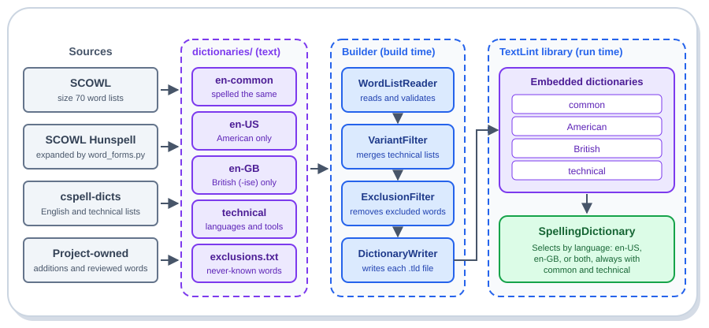

# Dictionaries

This folder holds the plain-text word lists from which the TextLint dictionaries are built. The lists are
data, not code: they are reviewed as text, edited by hand where noted below, and converted into compact binary
dictionary files at build time by the dictionary builder (`src/DemaConsulting.TextLint.DictionaryBuilder`), which the
build of the `DemaConsulting.TextLint` library runs; the library embeds the results. Editing a list is enough: the
next build converts it again. No binary dictionary is ever committed.

The diagram below shows where the words come from and how they reach the library.



## Layout

The folder is the tag; there is no manifest. Each top-level folder is one dictionary, and the folder name is the
dictionary name that the build passes to the builder.

| Folder | Content |
| ------ | ------- |
| `en-common/` | English words spelled the same in American and British (-ise) English, plus `additions.txt` |
| `en-US/` | American-only spellings |
| `en-GB/` | British (-ise)-only spellings |
| `technical/language/` | Programming-language keyword and API lists, and the font names list (8 files) |
| `technical/general/` | General technical lists and the project-owned additions and tools lists (9 files) |
| `technical/variant-keep.txt` | Reviewed spelling variants that are genuine programming terms |
| `exclusions.txt` | Reviewed words that must never be known in any dictionary (a file, not a dictionary) |

Each English folder holds one file per source, so that a reviewer can see where every word comes from (see
_English Sources_ below). The language lists are csharp, dotnet, typescript, node, html, css, powershell, and fonts
(the names of font families such as `Segoe`, `Consolas`, and `Roboto`, which appear in documentation, style sheets,
and project files in every language). The
general lists are software-terms, companies, filetypes, public-licenses, fullstack, npm, k8s, additions, and tools.
The tools list (`technical/general/tools.txt`) is a hand-curated, living list of developer tool names (build systems,
compilers, linters, test runners, documentation and diagram tools, version control and CI, containers and cloud
command-line tools, editors, databases, and the .NET and DEMA toolchains) that the owner extends on request; it is
not generated or pinned, and the refresh script never writes it.

An ordinary dictionary reads every `.txt` file beneath its folder. The technical dictionary reads only the three
places above and fails the build for a word list anywhere else in its folder. The builder also fails the build if
a folder holds word lists but is not declared to it, so a mistyped folder name cannot silently drop a list.

## English Sources

Every English list file starts with comment lines that state its source, pinned version, license, and the way it
was generated. In priority order (a word is written only to the first file that has it):

| File (in each of `en-common/`, `en-US/`, `en-GB/`) | Content |
| -------------------------------------------------- | ------- |
| `common.txt`, `us.txt`, `gb.txt` | The SCOWL word lists, size 70, American and British (-ise) |
| `hunspell.txt` | Forms generated from the SCOWL Hunspell en_US-large and en_GB-large dictionaries |
| `cspell.txt` | The maintained cspell-dicts English lists (additional words, acronyms, shared, -ize, -ise) |
| `hunspell-legacy.txt` | Forms generated from the older SCOWL Hunspell en_US-large dictionary that cspell-dicts keeps |
| `cspell-legacy.txt` | The cspell-dicts legacy English list, only the words that SCOWL size 80 also lists |

The Hunspell dictionaries store stems with affix flags; `word_forms.py` expands them with the prefix and suffix
rules of the `.aff` files, including cross products, so the committed lists stay plain text and the dictionary
builder does not change. The expander is checked against `hunspell-reader`, the independent expander that cspell
uses, and produces identical word sets for all three dictionaries. The pinned SCOWL release derives few forms
(it only uses an affix flag where every derived form is in its own list); the older dictionary derives many more
(for example `testability`, `reviewable`, `precomputed`, `unannotated`), which is why both are used. Two upstream
files were evaluated and not imported: the cspell-dicts hyphenated-word list (it adds only three word fragments)
and its contractions list (it adds forty-six odd double contractions such as `can't've`), and two sources were
rejected: the compiled cspell `en_US.txt` (it has no per-source provenance) and the `en_GB-MIT` list (it mixes
Australian and Canadian data, a list of unknown source, and an LGPL-filtered dictionary).

## Spelling Regions (the Classification Rule)

The language setting decides American and British spellings, so every English word that is not already in the
SCOWL base lists is routed to `en-common`, `en-US`, or `en-GB` by one rule, implemented in `word_forms.py`, using
lower-case comparison and the first test that applies:

1. **Strict**: the word is in the SCOWL size 70 lists (variant level 1). In both the American and the British list
   it is common; in only one it belongs to that region.
2. **Wide**: the word is in the wider SCOWL lists (size 80, variant level 3). In only one region's list it belongs to
   that region; in both it is common. This data is used only to classify; it never adds a word by itself.
3. **Counterpart**: SCOWL does not know the word, but a regular spelling pattern (`-or`/`-our`, `-ize`/`-ise`,
   `-er`/`-re`, `-og`/`-ogue`, `-l`/`-ll`, `-ered`/`-red`, `-aft`/`-aught`, `-lf`/`-lph`, `-p`/`-pp`, and the others
   listed in `word_forms.py` with the SCOWL word pairs each covers) turns it into a word that SCOWL lists for exactly
   one region. The word is then the other region's spelling.
4. **Contained**: SCOWL does not know the word and no pattern applies, but the word is a SCOWL word of at least five
   letters that only one region lists, with prefixes and suffixes that the Hunspell affix rules add (`un`, `re`,
   `s`, `'s`, `able`, `ing`, and so on). `unmaneuverable` is `un` plus `maneuverable` and is therefore American;
   no pattern reaches it, because maneuver and manoeuvre differ in several places. The affixes are required because
   a regional word also occurs by accident inside unrelated words (`liter` in `alliteration`); without them 188
   common words would have moved to American and 68 to British, nearly all wrongly. The longest regional word
   decides, a tie decides nothing, and a word that the other region also lists (`license`) never decides. The
   handful of genuine accidents (the cities Bourges and Deventer, `reprise's`, `formers`) are listed with a reason
   in `CONTAINMENT_ALLOWED`; the refresh output lists every word this test moves, so a new one is seen at once.
5. **Hint**: otherwise the region of the source applies: a form generated from a regional stem inherits the region of
   the stem, the cspell `-ize` list is American, and the `-ise` list is British.
6. **Neutral**: otherwise the word is common.

A British spelling therefore never lands in `en-common` or `en-US` (for example `catalogue`, `labelled`, `honoured`,
and `modelling` are in `en-GB` only), even when a source such as cspell's legacy list accepts it for American
English. When two sources disagree about a word, a regional proposal beats a common one, and a word proposed for both
regions is common.

Three further rules keep the split sound:

- **Case is folded first.** The builder and the library fold every word to lower case, so the region of a word is
  decided by its lower-case form and every capitalized form is written to that same region. A name such as `Honor`
  therefore cannot carry `honor` into `en-GB`. A word that exists only in capitalized form (a proper name) is
  decided by its capitalized forms.
- **British English is -ise only.** An -ize form that has a known British -ise counterpart (`organize` for
  `organise`, and `glamourize` for `glamorise`) is never written to `en-GB`; a Hunspell stem that is such a form is
  skipped with all its generated forms (`colourize`, `colourized`), and a common -ize word with such a counterpart is
  written to `en-US`. Words such as `size`, `capsized`, and `resized` have no counterpart and are unaffected.
- **A spell check does not know the part of speech.** Words whose British form differs only by part of speech
  (`license` and `licence`, `practice` and `practise`) are accepted in both forms by `en-GB`, because one form is
  common to both dialects. This is inherent and is not a leak.

`refresh.py` checks the finished lists before it writes anything and stops when a word that SCOWL lists only for
British English is in `en-common` or `en-US`, when a word that SCOWL lists only for American English is in
`en-common` or `en-GB`, when an unlisted word in `en-common` or `en-US` is a British-only SCOWL word with affixes (or
the reverse), when `en-GB` has an -ize form with an -ise counterpart, when one of a curated set of well
known pairs (`honor`/`honour`, `color`/`colour`, `center`/`centre`, `catalog`/`catalogue`, `labeled`/`labelled`,
`organize`/`organise`, `analyze`/`analyse`, `modeling`/`modelling`, `judgment`/`judgement`, and a few more) is in the
wrong region, or when a word that is valid in both dialects (`program`, `license`, `practice`, and a few more; British
English keeps `program` for computing and accepts the verb `license`) is missing from either. Patterns were not added
for `-ce`/`-se` (`license`/`licence`) and `-m`/`-mme` (`program`/`programme`) for that reason. The library test suite
repeats the pair check over the committed lists and through the public lookup.

## Reviewed Common Words

`en-common/additions.txt` is the hand-written list of words that are standard in every English variant although
the SCOWL lists classify them as regional (or lack them): the owner's override of the classification rule above.
Its first words are `oversize`, `oversized`, and `oversizes`; SCOWL lists `oversized` for British English at variant
level 0 and for American English only at level 4, and the reverse for `oversize`, so the size 70 base lists give each
form to one dialect by accident, and every American project that writes "oversized" would see a false finding. The
other words are `abaci` and `cactuses`, standard plurals that SCOWL lacks. The
file's header states the review rule and the evidence: add a word only when both dialects use it, never a genuine
spelling variant, and never merely to silence an error.

The refresh script reads the file but never writes it. It leaves the words out of every generated list, so the file
is the only place that classifies them; its self-checks treat them as deliberate overrides instead of leaks, but
still fail for an invalid entry, an entry that is on a cspell-dicts exclude list, an -ize form that has a known -ise
counterpart, or an entry that is still in an American or British list. The dictionary builder needs no special rule:
it builds every list of the common folder into the common dictionary, and a lookup combines it with the regional one.
If a word is in both a common and a regional list anyway, the common list wins, because the word is known in every
selection and the duplicate is harmless; the builder never reports it.

## Exclusions

The imported lists are faithful to their sources, and some entries hide real typos: a misspelling the source
contains, a fragment of a word, or a rare real word that is almost always a mistyped common one (`curser` for
`cursor`, `operants` for `operands`). `exclusions.txt` is the reviewed list of such words. The dictionary builder
removes every word on it from every dictionary, in every letter case, so the word is reported as unknown; the imported
lists are never edited. The builder fails the build for a word on the list that is in no dictionary, so a stale entry
is noticed, and for a list that cannot be read. The file's header states the review rule: add a word only when it is a
misspelling, a fragment, or a rare word that is overwhelmingly a typo of a common word, and never an accepted
spelling variant or a technical term. The cspell-dicts exclude lists are honored separately by the refresh script.
The first entries were found by comparing the expanded lists with a large sample of common misspellings; the
sample is third-party data under a share-alike license, used for measurement only and not part of this repository.

## Spelling Variants in the Technical Lists

The language setting (American or British English) must decide ordinary spelling variants, so the technical
dictionary must not make them known in every language. When it combines the technical lists, the builder
removes from the `general` lists every word that is in the American-only or the British-only dictionary,
unless the word is also in a `language` list or in `variant-keep.txt`. For example `favorite`, `flavors`, and
`aluminum` are removed, while `color` and `grey` stay because the CSS list has them, and `tokenizer` stays because
it is in the reviewed list. The imported lists themselves are never edited to apply this rule.

`variant-keep.txt` is curated by hand. Add a word only after a reviewer has confirmed that it is a programming term
and a variant spelling that would otherwise be removed; the builder fails the build for a word in it that is not a
spelling variant, which keeps the list short, and the build output states how many variants were kept through the
language lists, kept through `variant-keep.txt`, and removed.

## File Format

The format is enforced by the builder, which reports every violation with its file and line:

- UTF-8 text with LF line endings (a byte order mark and CRLF are tolerated).
- One entry per line. Spaces and tabs around an entry are trimmed. Blank lines and lines whose first
  non-blank character is `#` are ignored. A comment cannot follow an entry on the same line.
- An entry is 1 to 64 characters: ASCII letters, Latin-1 letters (for example `é` and `ß`), and the straight
  apostrophe `'`. It must start and end with a letter and must not contain two apostrophes in a row. Digits,
  hyphens, dots, spaces, the typographic apostrophe, and letters of other scripts make the build fail.
- Order and repetition do not matter. Entries that differ only in letter case are the same word, and
  lookups ignore case. Capitalization is still recorded, so write names as names (`Paris`).
- Accents matter. The English lists contain both the accented and the unaccented spelling of accented
  words (`café` and `cafe`), so unaccented text is accepted and a wrong accent is still an error.

## Adding a Word

Choose the file by what the word is:

- A general technical or scientific term (for example `metafile`, `bigram`, `commitish`), or an inflection that no
  list has (`dialogs`, the plural of the known `dialog`): `technical/general/additions.txt`.
- The real, public name of a developer tool (for example `weasyprint`, `xunit`, `vstest`, `gcovr`) that no list has:
  `technical/general/tools.txt`. It must not be a misspelling (the entries were checked against the typo list of
  crate-ci/typos), a fragment of a name, or already known, and it is one lowercase word of letters, at least as long
  as the minimum word length. The owner extends this list on request; its header states the rules.
- A programming term that has an American and a British spelling and is in the American or British list
  (`tokenizer`): `technical/variant-keep.txt`.
- An ordinary English word that every dialect uses but that SCOWL lacks or classifies as regional (`oversized`,
  `abaci`): `en-common/additions.txt`.
- A British or American spelling of an ordinary word (`centre`, `labelled`): no list; it is a finding when the other
  dialect is selected.
- A product, a person, an internal abbreviation, or an identifier of one project: no list; it belongs to the `words`
  setting of that project.

Add genuine project-specific technical terms to `technical/general/additions.txt`, one per line. That file is
owned by the project and is never overwritten by the refresh script (nor is `tools.txt`); a spelling variant added
there is removed
by the rule above, so a genuine programming term in a variant spelling belongs in `technical/variant-keep.txt`
instead. The builder fails the build for a word in the keep list that is not a variant, so an inflection that is in
neither the American nor the British list (`dialogs`) goes in `additions.txt`. An ordinary English word that every
dialect uses but that SCOWL classifies wrongly belongs in `en-common/additions.txt` (see _Reviewed Common Words_).
Every word of the curated lists is written for this project from its own review, with a public definition as the
evidence, and no third-party word list is copied into them. Do not edit the imported files by hand, because the
next refresh replaces them, and never add a misspelling to hide a spelling error.

<!-- cspell:ignore vstest gcovr -->

## Provenance and Licenses

Every list file starts with comment lines that state its source, pinned version, license, and the command that
produced it. The technical lists come from the following cspell-dicts packages (the English lists are described
after the table):

| Lists | Source | Pinned to | License |
| ----- | ------ | --------- | ------- |
| `technical/general/software-terms.txt` | `@cspell/dict-software-terms` (default-on lists) | 5.4.8 | MIT |
| `technical/general/companies.txt` | `@cspell/dict-companies` | 3.2.13 | MIT |
| `technical/general/filetypes.txt` | `@cspell/dict-filetypes` | 3.0.18 | MIT |
| `technical/general/public-licenses.txt` | `@cspell/dict-public-licenses` | 2.0.17 | MIT |
| `technical/general/fullstack.txt` | `@cspell/dict-fullstack` | 3.2.9 | MIT |
| `technical/general/npm.txt` | `@cspell/dict-npm` | 5.2.55 | MIT |
| `technical/general/k8s.txt` | `@cspell/dict-k8s` | 1.0.13 | MIT |
| `technical/language/dotnet.txt` | `@cspell/dict-dotnet` | 5.0.15 | MIT |
| `technical/language/csharp.txt` | `@cspell/dict-csharp` | 4.0.8 | MIT |
| `technical/language/node.txt` | `@cspell/dict-node` | 5.0.9 | MIT |
| `technical/language/typescript.txt` | `@cspell/dict-typescript` | 3.2.3 | MIT |
| `technical/language/html.txt` | `@cspell/dict-html` | 4.0.16 | MIT |
| `technical/language/css.txt` | `@cspell/dict-css` | 4.1.2 | MIT |
| `technical/language/powershell.txt` | `@cspell/dict-powershell` | 5.0.17 | MIT |
| `technical/language/fonts.txt` | `@cspell/dict-fonts` | 4.0.6 | MIT |

`technical/general/tools.txt` is not in the table because it is not imported: it is a hand-curated list of public
tool names written for this project. The Homebrew install analytics (packages and applications, 365 days) were used
only to decide which tools developers commonly use, and every entry was checked against the typo list of crate-ci/typos
(`crates/typos-dict/assets/words.csv`) so that no known misspelling is accepted as a tool name. No third-party list
is copied into it, so it carries no third-party notice.

The English lists (the files named under _English Sources_ above) come from:

- `common.txt`, `us.txt`, `gb.txt`: SCOWL, <https://github.com/en-wl/wordlist>, size 70, variant level 1 (size 80,
  variant level 3 is used only to classify words). Tag `rel-2026.02.25`, commit
  `7e99edab8e32f9f9ea2b15f249ca8d4d67237410`. License: SCOWL permissive notice.
- `hunspell.txt`: the SCOWL Hunspell dictionaries `en_US-large` and `en_GB-large` (size 70) of the same release,
  expanded; the downloaded assets are pinned by SHA-256. Licenses: SCOWL notice and Hunspell affix (Kuenning)
  notice.
- `cspell.txt`: cspell-dicts `@cspell/dict-en_us` (additional words, acronyms) and `@cspell/dict-en-shared` (shared
  words, -ize and -ise lists, acronyms), commit `72b65202e1b774153003577073303c4ef1d72e4e` (package versions 4.4.43
  and 1.0.58); every downloaded file is pinned by SHA-256. License: MIT.
- `hunspell-legacy.txt`: the SCOWL 2020.12.07 Hunspell `en_US-large` that cspell-dicts keeps, expanded; same commit.
  Licenses: the SCOWL 2020.12.07 notices (including WordNet, Moby, and the UK wordlist) and the Hunspell affix
  notice.
- `cspell-legacy.txt`: the cspell-dicts `en_US` legacy list, only words that SCOWL size 80 also lists; same commit.
  License: MIT (the upstream provenance of the list is not documented).
The license notices are in `third-party/THIRD-PARTY-NOTICES.txt` at the root of the repository. The generated word
forms are modified (derived) data, which the notices and the list headers state, as the Hunspell affix license
requires. Packages
with other licenses (for example the LGPL cspell English dictionaries, the CC BY-SA misspellings list, and the compiled
cspell lists) are deliberately not used. The cspell `markdown` package is not imported because it contains no words.

The SCOWL base lists keep the common and the regional spellings apart: American is SCOWL spelling code `A`,
British (-ise) is code `B`, and the three lists are the intersection and the two differences of those two
sets; the other English sources are routed by the rule above. The technical lists are imported with their own
filter and are not de-duplicated against the English
lists, so a list stays faithful to its source; the spelling-variant rule above is applied by the builder.

## Refreshing the Lists

The imported lists are regenerated by `refresh.py`. It is a manual maintenance tool and is never run by the
build or by CI.

Prerequisites:

<!-- cspell:ignore PYTHONUTF ogue Kuenning Moby wordlist bigram commitish -->
<!-- cspell:ignore organise glamorise colourize colourized licence practise colour analyse ered manoeuvre -->
<!-- textlint:ignore catalogue labelled honoured modelling honour centre judgement programme -->
<!-- textlint:ignore curser operants glamourize -->
<!-- cspell:ignore Bourges Deventer unmaneuverable maneuverable Segoe Consolas -->

- Python 3.7 or later with SQLite 3.33.0 or later, git, and npm on the path. The scripts use nothing newer than
  Python 3.7 (checked with the `vermin` tool).
- Network access to GitHub and the npm registry.
- UTF-8 mode for Python, enabled by setting the environment variable `PYTHONUTF8` to `1` (on Windows, set it
  for the session, because the SCOWL importer fails on accented words otherwise).

Run it from the repository root:

```bash
python dictionaries/refresh.py --workdir <scratch-folder>
```

Creating the SCOWL database takes about five minutes the first time; pass the same `--workdir` again to reuse it. The
SCOWL repository itself is deleted and cloned again on every run, because its scripts are executed and a checkout left
in the work folder could have been modified; the cached database is trusted only through the word lists it exports,
which are checked against pinned hashes.
Use `--only english` or `--only technical` to refresh one family. The script prints the number of entries per
file, the number of entries that were dropped, and how many words each routing test decided, which belongs in the
pull request description. Every download is checked against the SHA-256 value pinned in the script, whether it was
just fetched or reused from the work folder (a cached file with the wrong hash is downloaded again), and so are the
cspell npm package tarballs, the exported SCOWL word
lists, and the installed `hunspell-reader` package tree; a mismatch stops the run with an error that names the input.
Every `npm` command runs with `--ignore-scripts`, so no package code runs before its hash or integrity is verified.
The run is all-or-nothing: every list is generated into a staging folder inside the work folder, checked, and only
then moved over the committed lists, with the old files restored if the move fails part way. Before it downloads
anything the run fails if a managed folder holds a list that no source declares and that is not curated, which is what
a removed or renamed source leaves behind; the files are named and a person deletes them or declares the source. To
move to a new upstream release, change the pinned versions and hashes at the top of the script and in
the table above, and recheck `exclusions.txt`: the build fails for an entry that no list has any more.

The Hunspell expander rejects a malformed `.aff` or `.dic` file with an error that names the file and line (for
example `en_US.aff:12: SFX line has 3 fields, at least 4 are needed`) instead of producing a wrong word set.
`python dictionaries/word_forms.py --self-test` runs the expander and routing self-tests (sample affix files,
malformed-input errors, case folding, the -ise rule, and the region check), and `python dictionaries/refresh.py
--self-test` runs the same tests plus tests of the script's file handling (verified downloads, stale lists, the
all-or-nothing installation). Run one of them after changing either script.

The imported English lists are generated data, not curated text, and are deliberately outside the review scope of
`.reviewmark.yaml`: a reviewer cannot judge two hundred thousand words, so the generator, its self-tests, the curated
lists (`exclusions.txt`, `additions.txt`, `tools.txt`, `variant-keep.txt`), and the third-party notices are in scope
and are
reviewed instead, and the self-checks and library tests above guard the output.

`python dictionaries/refresh.py --workdir <scratch-folder> --verify-expander` writes no list. It installs the pinned
`hunspell-reader` npm package (MIT, Node.js 22.18 or later) and checks that the Hunspell expander of `word_forms.py`
produces exactly the same word set for every pinned dictionary.
