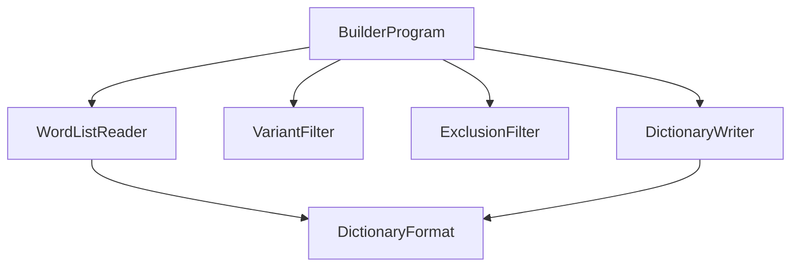

# DictionaryBuilder

## Architecture

The DictionaryBuilder is a **build-time system**: a small console program that is run by the build of
the `DemaConsulting.TextLint` library and is never packaged, published, or run by a user. Its single
job is to turn the plain-text word lists kept under `dictionaries/` into the binary dictionary files
that the library embeds. It is modeled as its own system, rather than as untracked build script,
because it produces data that ships inside the library: its quality is therefore part of the quality of
the product, and it has its own requirements, design, verification, and tests.

The system consists of six units and no subsystems:

`BuilderProgram` is the entry point. It parses the command line, asks `WordListReader` to read and
validate the word lists of each declared dictionary, asks `VariantFilter` to combine the technical lists
under the spelling-variant rule, asks `ExclusionFilter` to remove the words of the reviewed exclusions list
from every dictionary, asks `DictionaryWriter` to serialize the result, writes the files
all-or-nothing, and reports every problem in the compiler's error format. `WordListReader` and
`DictionaryWriter` both rely on `DictionaryFormat`, which holds the definitions that the writer and the
library's dictionary reader must agree on bit for bit: the case fold, the hash, the capitalization
classification, and the layout constants. `VariantFilter` and `ExclusionFilter` are pure functions over sets of
folded words and need none of them. `DictionaryFormat` is the one unit whose source file is shared: the library project
compiles the same file, so the builder that writes a dictionary and the library that reads it can never
disagree. For that reason the file lives in the builder's project folder, belongs to this system, and
declares the namespace `DemaConsulting.TextLint.Dictionaries`, which is the namespace the library uses
for the code that reads the files.

The builder produces four dictionaries from the word lists under `dictionaries/`: the English words common
to both dialects, the American-only words, the British-only words, and the technical terms. The technical
dictionary is the only one that is combined from several kinds of list, as described under _Word Lists_
below and in the _VariantFilter_ design. The word lists themselves are generated (the English lists, by
`dictionaries/refresh.py` from SCOWL, Hunspell dictionaries, and cspell-dicts word lists) or curated by hand;
the builder neither knows nor cares which, and the reviewed exclusions list is how the project removes an
imported word that hides a real typo without editing the imported data.

## External Interfaces

**Command Line**: the input from the build.

- _Type_: command line.
- _Role_: consumer (the build starts the builder).
- _Contract_: `--input <word-list-folder> --output <folder> <name> [<name> ...]`, optionally followed by
  `--technical <name> --variants <name> [--variants <name> ...]` and by `--exclusions <word-list-file>`. For
  each name the builder reads the word
  lists beneath `<word-list-folder>/<name>/` and writes `<folder>/<name>.tld`. Dictionary names consist of
  letters, digits, hyphens, and underscores only, and two names that differ only in letter case are one name
  (they would be one folder and one file on a case-insensitive file system). `--technical` declares which of the
  names is the technical
  dictionary, and each `--variants` names a declared dictionary whose words are regional spelling variants
  (the American-only and the British-only dictionaries); the two options must be given together.
  `--exclusions` names one word-list file whose words are removed from every dictionary.
- _Constraints_: exit code 0 on success, 1 when the word lists or the declarations are invalid or the files
  cannot be written (nothing is changed), 2 when the command line is invalid (including an option with an
  empty value), and 3 when the output folder could not be left clean and consistent: a write failed and the file
  system also prevented restoring the previous files, or a temporary file or backup could not be deleted (a fatal
  condition, reported with the affected files and the backups).

**Word Lists**: the input data.

- _Type_: files under the input folder, one sub-folder per dictionary.
- _Role_: consumer.
- _Contract_: UTF-8 text, one entry per line. A line whose first non-blank character is `#` is a comment
  and blank lines are ignored. Spaces and tabs around an entry are trimmed; a byte order mark and CRLF
  line endings are tolerated. An entry is 1 to 64 characters made of ASCII letters, Latin-1 letters, and
  the straight apostrophe; it starts and ends with a letter and has no two apostrophes in a row.
  Capitalization is meaningful because it is recorded; order and repetition are not.
- _Constraints_: any other character, including digits, hyphens, spaces, the typographic apostrophe,
  and letters of other scripts, makes the entry invalid.

The folder is the tag, and there is no manifest. An ordinary dictionary reads every `.txt` file (the extension in any
letter case) beneath its
folder. The technical dictionary's folder is organized instead as: `language/` for the keyword and API lists of
programming languages, `general/` for every other technical list, and `variant-keep.txt` for the reviewed list of
spelling variants that are programming terms. A word list anywhere else in the technical folder is an error. Every
comparison of a dictionary, folder, or list name ignores letter case, so the builder behaves the same on every file
system. The
lists imported from third-party sources are kept as faithful to their source as possible and are never edited to
apply the variant rule or to remove a typo they contain; the variant rule is applied here, when the technical
dictionary is combined, and the words of the exclusions list are removed after that. The exclusions list is a single
file in the same format as every word list, kept in the word-list folder beside the dictionary folders. A word in it
is excluded in every letter case. The dictionaries are independent: a word that the lists of two dictionaries both
contain (a reviewed common word that an imported list also gives to a regional dictionary) is built into each of them,
which is harmless because a lookup combines the common dictionary with the regional one, and is never an error.

**Dictionary Files**: the output data.

- _Type_: binary files, one per declared dictionary, with the extension `.tld`.
- _Role_: provider.
- _Contract_: the layout defined in the _DictionaryFormat_ design. The files are deterministic and
  contain no timestamp or machine data.
- _Constraints_: a file whose content would not change is not rewritten; either every changed file is
  installed or none is, except when the file system prevents the restoration after a failed write, which is a
  reported fatal condition and never silent.

**Standard Output and Standard Error**: progress and diagnostics.

- _Type_: standard I/O.
- _Role_: provider.
- _Contract_: standard output receives one summary line per dictionary (path, word count, size, and
  whether the file was written or unchanged); the line of the technical dictionary also states how many
  spelling variants were kept through language lists, kept through the reviewed list, and stripped, and when an
  exclusions list was given every line states how many words were excluded from that dictionary.
  Standard error receives each problem as `path(line): error: message`, or `path: error: message` when the
  problem has no line, which MSBuild and editors turn into clickable errors.
- _Constraints_: on any problem the output folder is left as it was; if it cannot be left as it was, or a temporary
  file cannot be deleted, the error stream says so, names every affected file, and names every backup that holds a
  previous version.

## Dependencies

The system uses only the .NET base class library. It has no OTS items, no shared packages, and no
dependency on the TextLint library or the TextLint tool; the dependency runs the other way, because the
library's build runs the builder. The source file of `DictionaryFormat` is linked into the library
project. See the _TextLint_ design for how the build uses the builder.

## Risk Control Measures

N/A - not a safety-classified software item. The strict validation of the word lists and the refusal to
change any output when a problem exists protect the data quality of the product, not safety.

## Data Flow

1. The build starts the builder with the folder of word lists, the output folder, the dictionary names, and
   the declaration of the technical and variant dictionaries.
2. `BuilderProgram` validates the command line. A problem ends the run with exit code 2.
3. `BuilderProgram` lists the input folder once and resolves each declared ordinary name to the folder of that name
   as spelled on disk (ignoring letter case; a name that matches two folders is an ambiguity problem, and no match
   is a missing folder), then asks `WordListReader` to find the files of the folder; a folder that exists but cannot
   be searched is a problem, and the
   reader then reads the files. The reader reads the files in ordinal path order, decodes them strictly as UTF-8, validates
   each entry, folds it with `DictionaryFormat`, and merges it into one set of distinct words with the
   capitalization forms each word had. Every problem is collected, not just the first.
4. For the technical dictionary, `BuilderProgram` checks that every word list lies in the general folder, the
   language folder, or the reviewed list, has the reader read those three sources, and asks `VariantFilter`
   to combine them using the words of the variant dictionaries: language-list and reviewed-list words are kept,
   and a general-list word that is a spelling variant is stripped unless one of those lists has it.
5. `BuilderProgram` reports a declared dictionary with no words, a reviewed-list word that is not a spelling
   variant, and any folder that holds word lists but was not declared.
6. When an exclusions list was given and no problem has been collected so far, `BuilderProgram` asks
   `ExclusionFilter` to remove the excluded words from every dictionary and reports each excluded word that no
   dictionary had. (The list itself is read, and validated like any word list, together with the dictionaries, so a
   problem in it is reported with the others.)
7. If any problem was collected, all of them are written to standard error and the run ends with exit
   code 1, having written nothing.
8. Otherwise `DictionaryWriter` serializes each set in memory. `BuilderProgram` stages each changed file
   beside its target and installs them together. If an installation step fails, the files already installed are
   restored and the run ends with exit code 1. If the restoration itself fails, the backups that hold the
   previous versions are kept, the affected files and backups are reported, and the run ends with exit code 3.
   Temporary files and backups are deleted at the end; one that cannot be deleted is reported and also ends the run
   with exit code 3.
   When every file is installed the summary lines are printed and the run ends with exit code 0.

## Design Constraints

- Platform: runs on .NET 10 on Windows, Linux, and macOS, the platforms the library is built on.
- Determinism: the same word lists produce byte-identical files on every platform. Files are
  enumerated and sorted in ordinal order, the case fold is an explicit table owned by `DictionaryFormat` rather
  than culture-sensitive library behavior, byte order is fixed, padding is zero, and nothing
  machine-dependent is written.
- All-or-nothing: every file is produced in memory before any file is written, and the files are then
  installed together with a rollback, so a failed write leaves the previous set of dictionaries in place.
  The guarantee is stated honestly: a file system cannot be made to undo anything on demand, so when the
  rollback itself fails (for example a backup cannot be moved back, or a newly installed file cannot be
  deleted) the builder does not pretend otherwise. It keeps the backups, ends with a distinct exit code, and
  names every file left inconsistent and the backup that holds its previous version, so the build fails
  loudly and the maintainer can restore by hand.
- File system seam: the few file system calls whose failures cannot be provoked portably in tests (searching
  folders, listing output entries, reading files, moving files, and deleting files) go through one small class,
  `FileOperations`, which
  production code uses in its real form and tests replace with a version that fails on demand. It is part of the
  `BuilderProgram` unit.
- Failures are never mistaken for absence: a folder or file that exists but cannot be read is a reported problem,
  never an empty or missing one. Whether something exists is learned from the operation that uses it, and only a
  genuine "not found" condition means absent, so there are no existence checks that could hide an access or I/O
  failure. No exception handler discards an error; each reports it or describes what it could not undo.
- Results are values: the result types of the reader and the filter copy what they are given into immutable
  collections, so a result never changes after it is created.
- Strictness: the builder rejects what it does not understand instead of guessing, because the lists
  are edited by hand and imported from third-party sources and a silent skip would be a wrong dictionary
  in the product.
- Supported alphabet: words are ASCII and Latin-1 letters with an internal straight apostrophe. This is
  everything the English word lists need; other scripts are refused with an error, so adding one later is
  a deliberate change of the format and its fold.
- Variant spellings: the language setting must decide ordinary US-only and GB-only spellings, so a general
  technical term in a variant spelling is not made known in every language, while programming keywords and
  API names (the language lists) and a short reviewed list of programming terms are exempt. The rule is
  applied at build time and not in the import script, so the source lists stay faithful to upstream and the
  rule can be changed in one place.
- Excluded words: some entries of the imported lists hide real typos, and editing an imported list would be undone
  by the next refresh, so a reviewed list of excluded words is applied last, when the dictionaries are combined,
  and removes each word from every dictionary. An excluded word that no dictionary has is an error, so a stale
  entry is noticed instead of accumulating. The exclusions never alter the source lists.
- Safe code only: neither the builder nor the shared `DictionaryFormat` source contains unsafe code, pointers,
  or unsafe-code compiler options or analyzer suppressions. Safety is chosen over speed, and the library that
  consumes the files is held to the same rule.
- Code quality: the builder is compiled with the same analyzers and warnings-as-errors policy as the
  shipped library.

### Format Rationale

The dictionary files hold a sorted block of words and a precomputed hash table. The library reads each
embedded dictionary once into a managed byte array, validates its header, and answers lookups from that array
through bounds-checked spans, so a damaged file can only cause an error and never an out-of-range read. Because
the hash table is precomputed by the builder, loading involves no parsing and no building of a data
structure. The alternatives were to load the words into a general-purpose hash set at run time, which costs
allocation and start-up time proportional to the size of the dictionaries on every run, and to generate source
code, which compiles slowly with this many words. A faster scheme that would read the embedded resource in
place was rejected because it needs unsafe code; copying the bytes once is the chosen approach. The accepted
costs are a build step, larger embedded data, and one copy of the data in memory. There is deliberately no
requirement on speed: the format is justified here as a design choice, and nothing in the requirements depends
on it.
