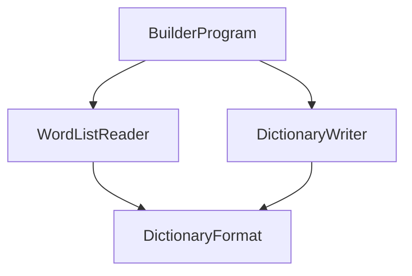

# DictionaryBuilder

## Architecture

The DictionaryBuilder is a **build-time system**: a small console program that is run by the build of
the `DemaConsulting.TextLint` library and is never packaged, published, or run by a user. Its single
job is to turn the plain-text word lists kept under `dictionaries/` into the binary dictionary files
that the library will embed. It is modeled as its own system, rather than as untracked build script,
because it produces data that ships inside the library: its quality is therefore part of the quality of
the product, and it has its own requirements, design, verification, and tests.

The system consists of four units and no subsystems:

`BuilderProgram` is the entry point. It parses the command line, asks `WordListReader` to read and
validate the word lists of each declared dictionary, asks `DictionaryWriter` to serialize the result, and
reports every problem in the compiler's error format. `WordListReader` and `DictionaryWriter` both rely
on `DictionaryFormat`, which holds the definitions that the writer and the library's future reader must
agree on bit for bit: the case fold, the hash, the capitalization classification, and the layout
constants. `DictionaryFormat` is the one unit whose source file is shared: the library project will
compile the same file, so the builder that writes a dictionary and the library that reads it can never
disagree. For that reason the file lives in the builder's project folder, belongs to this system, and
declares the namespace `DemaConsulting.TextLint.Dictionaries`, which is the namespace the library will use
for the code that reads the files.

## External Interfaces

**Command Line**: the input from the build.

- _Type_: command line.
- _Role_: consumer (the build starts the builder).
- _Contract_: `--input <word-list-folder> --output <folder> <name> [<name> ...]`. For each name the
  builder reads every `.txt` file beneath `<word-list-folder>/<name>/` and writes `<folder>/<name>.tld`.
  Dictionary names consist of letters, digits, hyphens, and underscores only.
- _Constraints_: exit code 0 on success, 1 when the word lists or the declarations are invalid (nothing
  is written), 2 when the command line is invalid.

**Word Lists**: the input data.

- _Type_: files under the input folder, one sub-folder per dictionary.
- _Role_: consumer.
- _Contract_: UTF-8 text, one entry per line. A line whose first non-blank character is `#` is a comment
  and blank lines are ignored. Spaces and tabs around an entry are trimmed; a byte order mark and CRLF
  line endings are tolerated. An entry is 1 to 64 characters made of ASCII letters, Latin-1 letters, and
  the straight apostrophe; it starts and ends with a letter and has no two apostrophes in a row.
  Capitalization is meaningful because it is recorded; order and repetition are not.
- _Constraints_: any other character, including digits, hyphens, spaces, the typographic apostrophe,
  and letters of other scripts, makes the entry invalid.

**Dictionary Files**: the output data.

- _Type_: binary files, one per declared dictionary, with the extension `.tld`.
- _Role_: provider.
- _Contract_: the layout defined in the _DictionaryFormat_ design. The files are deterministic and
  contain no timestamp or machine data.
- _Constraints_: a file whose content would not change is not rewritten.

**Standard Output and Standard Error**: progress and diagnostics.

- _Type_: standard I/O.
- _Role_: provider.
- _Contract_: standard output receives one summary line per dictionary (path, word count, size, and
  whether the file was written or unchanged). Standard error receives each problem as
  `path(line): error: message`, or `path: error: message` when the problem has no line, which MSBuild
  and editors turn into clickable errors.
- _Constraints_: on any problem nothing is written to the output folder.

## Dependencies

The system uses only the .NET base class library. It has no OTS items, no shared packages, and no
dependency on the TextLint library or the TextLint tool; the dependency runs the other way, because the
library's build will run the builder. The source file of `DictionaryFormat` is linked into the library
by that later change.

## Risk Control Measures

N/A - not a safety-classified software item. The strict validation of the word lists and the refusal to
write any output when a problem exists protect the data quality of the product, not safety.

## Data Flow

1. The build starts the builder with the folder of word lists, the output folder, and the dictionary
   names.
2. `BuilderProgram` validates the command line. A problem ends the run with exit code 2.
3. For each declared name, `BuilderProgram` checks that the folder exists and asks `WordListReader` to
   read it. The reader reads the files in ordinal path order, decodes them strictly as UTF-8, validates
   each entry, folds it with `DictionaryFormat`, and merges it into one set of distinct words with the
   capitalization forms each word had. Every problem is collected, not just the first.
4. `BuilderProgram` reports a declared dictionary with no words and any folder that holds word lists but
   was not declared.
5. If any problem was collected, all of them are written to standard error and the run ends with exit
   code 1, having written nothing.
6. Otherwise `DictionaryWriter` serializes each set in memory, `BuilderProgram` writes each file unless
   an identical one already exists, prints the summary lines, and ends with exit code 0.

## Design Constraints

- Platform: runs on .NET 10 on Windows, Linux, and macOS, the platforms the library is built on.
- Determinism: the same word lists produce byte-identical files on every platform. Files are
  enumerated and sorted in ordinal order, the case fold is an explicit table owned by `DictionaryFormat` rather
  than culture-sensitive library behavior, byte order is fixed, padding is zero, and nothing
  machine-dependent is written.
- All-or-nothing: every file is produced in memory before any file is written, so a failure never leaves a
  half-updated set of dictionaries.
- Strictness: the builder rejects what it does not understand instead of guessing, because the lists
  are edited by hand and imported from third-party sources and a silent skip would be a wrong dictionary
  in the product.
- Supported alphabet: words are ASCII and Latin-1 letters with an internal straight apostrophe. This is
  everything the English word lists need; other scripts are refused with an error, so adding one later is
  a deliberate change of the format and its fold.
- Safe code only: neither the builder nor the shared `DictionaryFormat` source contains unsafe code, pointers,
  or unsafe-code compiler options or analyzer suppressions. Safety is chosen over speed, and the library that
  consumes the files is held to the same rule.
- Code quality: the builder is compiled with the same analyzers and warnings-as-errors policy as the
  shipped library.

### Format Rationale

The dictionary files hold a sorted block of words and a precomputed hash table. The library reads each
embedded dictionary once into a managed byte array, validates its header, and answers lookups from that array
through bounds-checked spans, so a damaged file can only cause an error and never an out-of-range read. Because
the hash table is precomputed by the builder, loading involves no parsing and no building of a data
structure. The alternatives were to load the words into a general-purpose hash set at run time, which costs
allocation and start-up time proportional to the size of the dictionaries on every run, and to generate source
code, which compiles slowly with this many words. A faster scheme that would read the embedded resource in
place was rejected because it needs unsafe code; copying the bytes once is the chosen approach. The accepted
costs are a build step, larger embedded data, and one copy of the data in memory. There is deliberately no
requirement on speed: the format is justified here as a design choice, and nothing in the requirements depends
on it.

### Open Items

- The technical lists are imported without removing spellings that exist in both American and British
  variants (for example both the -ize and the -ise form of a word in the same list), so such words are
  accepted for every language selection. Filtering them is pending a decision. The filter would live in
  the import script that produces the lists, as one function, and would need no change to the builder or
  to the format.
