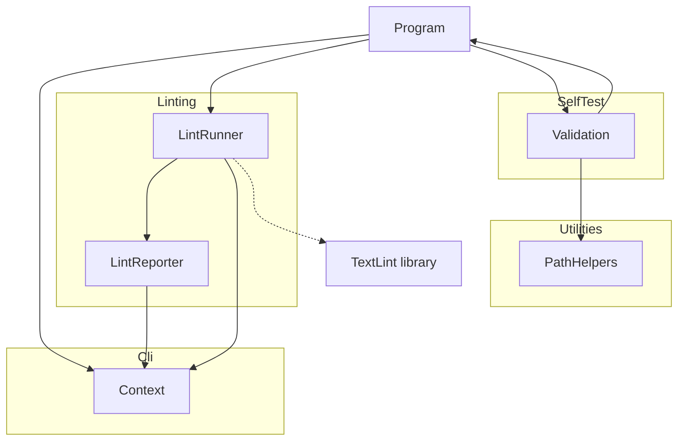

# TextLintTool

## Architecture

The TextLint Tool is a command-line application built on .NET. It is a **thin front-end** over
the `DemaConsulting.TextLint` library (see the _TextLint_ design): it parses arguments, writes
console and log output, sets exit codes, runs self-validation, and calls the library. **All
linting logic** - settings and configuration loading, file discovery and globbing, dictionaries,
tokenization, spell checking, and results - belongs in the library, and the tool must not contain
any of it. The tool depends on the library; the library never depends on the tool.

It is structured as one
system containing one top-level unit (`Program`) and four subsystems (`Cli`, `Linting`, `SelfTest`,
`Utilities`):

`Program` is the entry point. It creates a `Context` from the `Cli` subsystem, dispatches to
`Validation` when `--validate` is passed and to `LintRunner` otherwise, and returns the exit code from
`Context`. `LintRunner` finds and loads the settings, calls the `TextLint` library, and hands the result to
`LintReporter`, which writes it through `Context`. `Validation` calls `Program.Run` recursively to exercise the
tool during self-testing, including real spell-checking scenarios, and uses `PathHelpers` to construct safe
temporary file paths.

## External Interfaces

**Command-Line Interface**: The primary input interface for tool invocation.

- _Type_: CLI.
- _Role_: Consumer (the host environment invokes the system with command-line arguments).
- _Contract_: Accepts arguments `-v`/`--version`, `-?`/`-h`/`--help`, `--silent`, `--validate`,
  `--results <file>`, `--result <file>` (legacy alias for `--results`), `--depth <n>`, `--log <file>`,
  `--config <file>`, `--root <dir>`, `--language <languages>`, `--allow-empty`, and
  `--max-parallelism <n>`, and any number of file patterns as positional arguments, which replace the `files`
  setting. A pattern may be relative or absolute, and on Windows may use backslashes; the library interprets it.
  Returns exit code 0 when every selected file was checked and no issue was found, and 1 for anything else:
  issues found, a file that could not be checked, no files selected (unless `--allow-empty`), a settings or
  usage error, or a failed self-validation.
- _Constraints_: Unknown, missing, empty, repeated, or out-of-range arguments cause exit code 1 and an error
  message on stderr. Running with no file patterns and no `files` setting is a usage error with guidance, not a
  success.

**Standard Output**: Normal program output written to `Console.Out`.

- _Type_: Standard I/O.
- _Role_: Provider.
- _Contract_: Writes version, banner, help text, validation summary, or the result of a check depending
  on the flags provided. The result of a check is one line per finding in the compiler style
  `file(line,column): error: message`, one line per skipped or unchecked file in the style
  `file: info|error: message`, and a summary line; a notice precedes them when no settings file was found.
  Suppressed when `--silent` is active; the log file still receives all output.
- _Constraints_: Human-readable text. The compiler-style lines are the machine-readable contract: they are
  understood by editors, build servers, and CI log parsers.

**Standard Error**: Error message output written to `Console.Error`.

- _Type_: Standard I/O.
- _Role_: Provider.
- _Contract_: Writes error messages in red when a failure of the tool or its input occurs: a usage or argument
  error, a settings error, a missing directory, an unsupported pattern or language, or an empty selection.
  Errors of the run itself are suppressed when `--silent` is active, but the exit code is still set to 1. An
  argument error is written even then, because it arises while the command line is parsed, before the output
  settings exist (the other DEMA command-line tools behave the same); it is not written to the log file, which
  may not have been opened.
- _Constraints_: Color output requires a terminal that supports `ConsoleColor`. Findings and per-file problems
  are results and go to standard output, not here.

**Settings File**: The optional input file `.textlint.yaml`.

- _Type_: File.
- _Role_: Consumer.
- _Contract_: The file named by `--config` is loaded as typed; otherwise `.textlint.yaml` in the root directory
  (`--root`, by default the current directory) is loaded when it exists, and no parent directory is searched.
  When there is none, the default settings apply and an information line says so. Reading, validating, and
  mapping the file is done by the library.
- _Constraints_: A file that exists but cannot be examined or read is an error, not an absent file.

**Log File**: Optional persistent output file.

- _Type_: File.
- _Role_: Provider.
- _Contract_: When `--log <file>` is supplied, all `Context.WriteLine` and `Context.WriteError`
  output is written to the file regardless of `--silent`. The file is truncated at open.
- _Constraints_: The path must be writable; failure to open the file raises an
  `InvalidOperationException` and causes exit code 1.

**Results File**: Optional self-validation results file.

- _Type_: File.
- _Role_: Provider.
- _Contract_: When `--results <file>` is supplied alongside `--validate`, self-validation results
  are serialized to the file. Extension `.trx` selects MSTest TRX format; `.xml` selects JUnit
  XML format.
- _Constraints_: Any other extension causes an error message and exit code 1; no file is written.

## Dependencies

- **DemaConsulting.TextLint** (library, same repository): the tool depends on this project for
  all linting functionality. `LintRunner` calls `SettingsLoader.LoadAsync`, `CommandLinePathResolver.Resolve`,
  `SpellChecker.CheckAsync`, and the `TextLintSettings`, `SpellCheckOptions`, `SpellCheckResult`,
  `SpellingIssue`, and `FileDiagnostic` types; `LintReporter` formats through `SpellingIssue.Format` and
  `FileDiagnostic.Format`. See the _TextLint_ design.

- **DemaConsulting.TestResults**: provides `TestResults`, `TestResult`, and `TestOutcome` for
  accumulating self-validation results.
- **DemaConsulting.TestResults.IO**: provides `TrxSerializer` and `JUnitSerializer` for writing
  results files.

## Risk Control Measures

N/A - not a safety-classified software item.

## Data Flow

1. The host environment starts the tool process and passes command-line arguments to
   `Program.Main`.
2. `Program.Main` registers a Ctrl+C handler that cancels a token, then calls `Context.Create(args)`, which
   parses the arguments and opens the log
   file if `--log` was specified. An `ArgumentException` or `InvalidOperationException` at
   this point is caught, written to stderr, and causes exit code 1.
3. `Program.RunCancellable(context, token)` inspects the parsed flags and dispatches to one handler:
   - `--version` flag → `context.WriteLine(Version)`, then return.
   - Otherwise, `PrintBanner` is called first; then:
     - `--help` flag → `PrintHelp(context)`, then return.
     - `--validate` flag → `Validation.Run(context)`.
     - No flags → `LintRunner.Run(context, token)`.
4. `LintRunner.Run` resolves the root directory, finds and loads the settings, lets the library turn the
   command-line patterns into a search directory and patterns, applies the language override, calls
   `SpellChecker.CheckAsync`, and calls `LintReporter.Write`. It marks the run failed when the result has
   problems. Failures caused by the user's input or environment are written to stderr as errors.
5. `Program.Main` returns `context.ExitCode` (0 if no errors were reported and the run was not marked failed,
   1 otherwise).

## Design Constraints

- Platform: targets net10.0 on Windows, Linux, and macOS.
- Threading: the tool's own code runs on one thread; the library checks files on several threads, and `LintRunner`
  waits for it once, at the boundary of the synchronous entry point (a console program has no synchronization
  context to deadlock on). No shared mutable state between invocations.
- Immutability: `Context` properties are set once at construction via `init` accessors and are
  read-only thereafter.
- Resource lifecycle: `Context` implements `IDisposable`; callers must dispose it to flush and
  close any open log file handle.
- Path safety: all caller-supplied path components are validated by `PathHelpers.SafePathCombine`
  before file-system use.
- Layering: the tool is a thin command-line front-end. No linting logic (configuration loading,
  file discovery, dictionaries, tokenization, spell checking, results) may be added to the tool;
  it belongs in the `DemaConsulting.TextLint` library, which the tool calls. The tool owns only policy and
  glue: where the settings file is looked for, which command-line values override which settings, how each
  failure is reported, and the exit codes.
- Third-party notices: the tool package bundles the library assembly, which embeds third-party word
  lists whose licenses require their notices to accompany the data. The tool project therefore packs
  `THIRD-PARTY-NOTICES.txt` at the root of the package, as the library project does for its own package.
